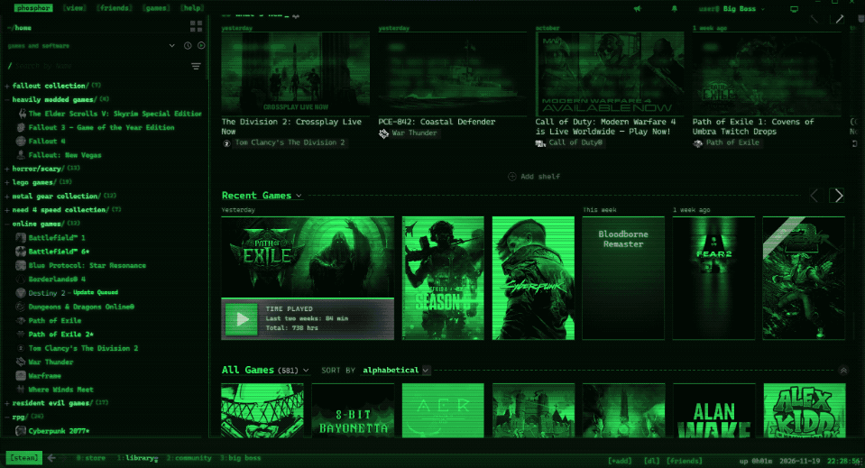

# Phosphor

**Steam as a tiling terminal on a phosphor CRT.** A Steam client theme for [Beyond Steam](https://github.com/OriginalSwayze/Beyond-Steam) and [Millennium](https://steambrew.app).

- **A tiling layout:**
  - Two panes, *library* and *main*, sit edge to edge with box-drawing borders and inset titles (`┤ library ├`).
  - A one-line title row at the top: `[phosphor] [view] [friends] [games] [help]` and `user@name`.
  - A **tmux-style status line** along the bottom: `[steam] 0:store 1:library* 2:community 3:you`, the dock as `[+add] [dl] [friends]`, and uptime, date and clock.
- **One color, many brightnesses:**
  - Everything is monospace and glows.
  - The selected game is in **reverse video**, and installed games are marked `*`.
  - Section headings read `## name_` with a blinking cursor, and Play is `$ ./play`.
  - Covers and art turn monochrome phosphor (optional).
- **A real command line:** press **:** and type `library`, `store`, `downloads`, `friends`, `find <name>` to filter the game list, `clear`, or `help`.
- **CRT:** scanlines, a slow roll bar, a curved-glass vignette, a gentle flicker, and a power-on self test when Steam opens.

## Install

- **With [Beyond Steam](https://github.com/OriginalSwayze/Beyond-Steam) (easiest):** in Steam press **Ctrl+Shift+B**, open
  **Get more** and install **Phosphor**.
- **By hand:** download **Phosphor.zip** from the [latest release](https://github.com/OriginalSwayze/Phosphor/releases/latest) and unzip
  it into `%APPDATA%\Beyond Steam\themes\Phosphor` (Beyond Steam) or `Steam\millennium\themes\Phosphor` (Millennium).

## Options

In Beyond Steam's **Theme options** tab (or **Millennium → Themes → Phosphor**) you can change:

Phosphor (Green, Amber, White, Ice, Rose) · Images (Monochrome / Color) · Scanlines (Normal / Heavy / Off) · Density · What's New · Readout · Startup screen · Motion · Privacy

Everything here is original: no other game's names, logos, art or fonts. Fonts are ones that ship with Windows.

## License

MIT, see [LICENSE](LICENSE).
